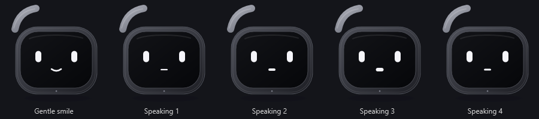

# Miu

A small Windows desktop companion with an expressive mascot, push-to-talk voice, read-only Gmail, and a short list of useful device commands. Built with native WPF rather than a browser runtime.



**Version 0.1.0 preview · Windows x64 · MIT-licensed original code.** Optional connections are configured by each user. No paid subscription is required for the desktop app or local voice features.

[Downloads](https://github.com/KumarManuSaraswat/miu/releases) · [Build status](https://github.com/KumarManuSaraswat/miu/actions/workflows/windows.yml) · [Commands](docs/COMMANDS.md) · [Support](SUPPORT.md) · [Contribute](CONTRIBUTING.md)

## Start

Download `miu-0.1.0-windows-x64.zip` from [Releases](https://github.com/KumarManuSaraswat/miu/releases), extract it into a writable folder, and double-click **Start Miu.cmd**. Keep its folders together. Windows with .NET Framework 4.8 is required; Windows 11 x64 is the recommended target. The executable is currently unsigned. Releases include a SHA-256 checksum file for verifying downloads.

The lean release contains the app and setup scripts. Windows voices work when installed. For offline English recognition and the more natural English voice, run these once from the extracted folder:

```powershell
powershell.exe -NoProfile -ExecutionPolicy Bypass -File .\scripts\setup-voice.ps1
powershell.exe -NoProfile -ExecutionPolicy Bypass -File .\scripts\setup-natural-voice.ps1
```

Restart Miu after setup. These scripts download upstream speech components with their own licenses; they are not bundled in the lean ZIP. See [third-party notices](docs/THIRD_PARTY.md) and [release instructions](docs/RELEASE.md).

- Click the mascot to open chat; drag it to move it.
- Tap the microphone or press **Ctrl+Alt+Space**. Wait for **Listening offline**, speak one request, then pause.
- The meter shows input activity. Uncertain recognition is put in the message box for review before anything runs.
- Tap the mic during a reply to interrupt and start listening. Press **Esc** to cancel.
- Open **Reactions** for 24 faces. Open **Settings → Choose a companion preset** for face, motion, and voice-speed profiles.
- Close chat to keep the mascot. Use its right-click or tray menu to sleep or quit.

The microphone is off when idle. Recognition currently supports English, with accuracy depending on the microphone, accent, and background noise. The app is a small command assistant; it cannot perform arbitrary computer tasks.

## What it can do

| Feature | Example | Connection |
| --- | --- | --- |
| Local facts | “What time is it?”, “Check my battery” | None |
| Open supported apps | “Open calculator”, “Open downloads” | None |
| Notes and volume | “Take a note buy milk”, “Volume down” | None |
| Expressive companion | “Look playful”, “Show reactions” | None |
| Voice conversation | One spoken turn at a time | Optional local speech downloads |
| Read and search Gmail | “Latest email”, “Emails from Alex” | Your Google Desktop OAuth setup |
| Open-ended AI chat | Ask a general question | Your eligible Gemini API project |
| Community presets | Load curated companion profiles | Optional Neon-backed catalog |

See the [command guide](docs/COMMANDS.md). Commands use an explicit allowlist. Neither model replies, email text, nor downloaded presets can execute arbitrary commands.

## Optional connections

### Gmail

Follow [Gmail setup](docs/GMAIL_SETUP.md), import your own Google Desktop OAuth JSON, and sign in. Only `gmail.readonly` is requested. Miu does not send, delete, or mark messages read. Gmail results are processed locally and are not added to AI conversation context. A shared public OAuth client has additional Google verification requirements; the release does not ship the maintainer's credentials.

### AI chat

Local commands and speech work without an AI key. Optional Gemini chat sends your typed or recognized chat text and bounded recent chat context to Google. It requires your own eligible API project and acceptance of Google's current terms. Free quotas, region and age restrictions apply; free availability is not universal or unlimited. Keep paid billing disabled if you need a zero-cost setup. Miu cannot verify your project's billing status.

Use **Settings** to configure a key and model. Consult [Gemini pricing](https://ai.google.dev/gemini-api/docs/pricing), [terms](https://ai.google.dev/gemini-api/terms), and [privacy details](PRIVACY.md) before enabling it. No API key is included in a release.

### Neon community catalog

The optional service in [services/catalog](https://github.com/KumarManuSaraswat/miu/tree/main/services/catalog) stores curated presets in **Neon Postgres** and exposes a small read-only API through a **Cloudflare Worker**. Profiles such as Focus and Cheerful contain only a known face, speaking speed, and reduced-motion preference.

```text
Miu -- explicit public GET --> Cloudflare Worker -- read-only query --> Neon Postgres
```

Database credentials stay in the Worker secret store. The desktop app receives no database password and sends no email, chat, audio, or account credentials to the catalog. A fetch shares ordinary connection metadata, including IP address, with the host. There is no background refresh or user-upload endpoint.

Three built-in profiles work offline. The [public Miu catalog](https://miu-preset-catalog.kumar-saraswat-s-125.workers.dev/v1/presets) is live with six curated profiles. To try it, open **Companion presets → Community catalog**, paste this address, and click **Load community presets**:

```text
https://miu-preset-catalog.kumar-saraswat-s-125.workers.dev/v1/presets
```

Apply a profile explicitly after loading. The published **v0.1.0** app still has a blank catalog address by default; no endpoint was added to its release assets. Loading the catalog is a manual, optional connection.

The service runs on Neon Free and Workers Free. Its live response and all six profiles have been checked with the desktop catalog client. Hosting quotas still apply; this is not a promise of unlimited availability. Built-in presets remain available if the service is unavailable. Deployment instructions include quota checks and read-only credentials.

## Memory and privacy

The native app has no resident language model. Local checks observed roughly 100–150 MiB for the app; speech helpers add temporary memory while active. A short recognition test used about 149 MiB of worker working set, and a natural-voice sample peaked around 135 MiB. These are sample measurements, not fixed limits. The UI's memory figure covers the app, not separate helper processes.

Vosk loads for each listening turn; Piper loads to generate each spoken reply. Both exit when finished. Chat stays in memory for the session. Notes and Windows-encrypted account secrets stay in `%LOCALAPPDATA%\Miu`. No app telemetry or automatic mail polling is implemented. See [PRIVACY.md](PRIVACY.md) for optional network services and data removal.

## Develop and validate

The desktop build uses the .NET Framework compiler supplied with Windows. It needs no .NET SDK, NuGet, npm, or Python. Node.js is needed only for the optional catalog service.

```powershell
git clone https://github.com/KumarManuSaraswat/miu.git
cd miu
.\build.ps1 -Test
.\scripts\verify-release.ps1 -SelfTest
.\scripts\package-release.ps1
```

The desktop suites cover commands, safety, Gmail parsing, speech handling, and the catalog client. They make no live Gmail or AI calls. The catalog has separate tests and an opt-in live database check described in its README. GitHub Actions builds the app, runs checks, and produces verified artifacts; it does not publish or deploy automatically.

Public packages use an explicit file allowlist, exclude local configuration and speech bundles, and include SHA-256 checksums. Read [release instructions](docs/RELEASE.md) before distributing a build. Clean-machine voice setup, microphone compatibility, and hosted services need their own checks.

## Contribute and support

Start with [CONTRIBUTING.md](CONTRIBUTING.md). Bug reports, documentation improvements, accessibility feedback, and reproducible speech issues are welcome. Use [SUPPORT.md](SUPPORT.md) for help and [SECURITY.md](SECURITY.md) for private vulnerability reports. See the [code of conduct](CODE_OF_CONDUCT.md), [governance](GOVERNANCE.md), and [changelog](CHANGELOG.md).

Miu is an independent project maintained by its repository owner and contributors. Original Miu source is under the [MIT license](LICENSE); upstream components retain their own licenses. It is not affiliated with the services it optionally connects to.

The [Neon sponsorship preparation notes](docs/NEON_SPONSORSHIP.md) describe eligibility and the remaining application steps. Neon does not require a project to use its database to apply. No sponsorship or funding is currently claimed.
