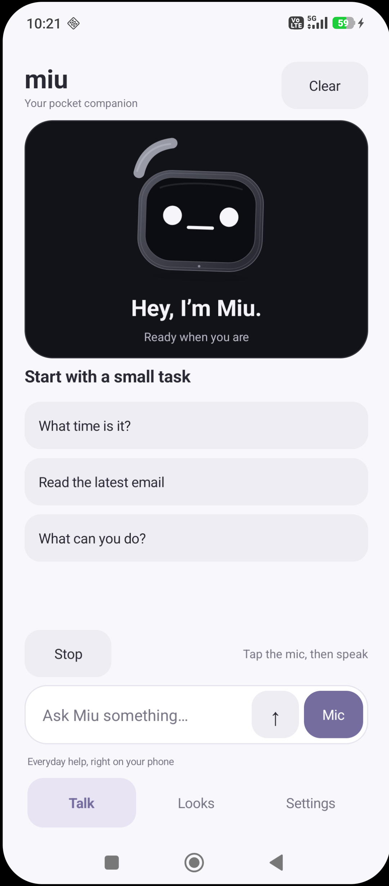
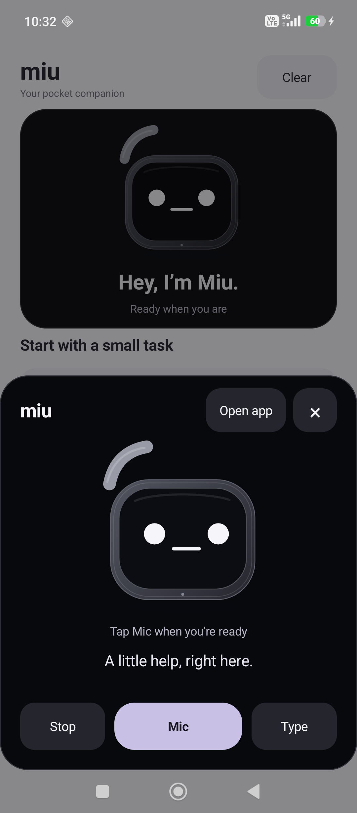

# Miu for Android

A small, native Android companion with a soft monochrome mascot, 24 animated expressions, tap-to-talk, local phone commands, optional Gmail reading, and reviewed WhatsApp messaging. No embedded browser, subscription, resident language model, or Miu account is required.

Miu is designed to stay useful in your pocket without a server. Its small offline conversation engine handles greetings, a few moods, company, jokes, ideas and simple arithmetic alongside device skills. Gemma 3 1B handles general conversation locally after the built-in skills. Its small model can make mistakes; it runs only for a reply and never controls device actions.

**Android 9+ ARM64 · Miu 1.0 · MIT app code; separate Gemma model terms**

<p> </p>

## Install and share

Download **miu-1.0.0-android.apk** from the [Android release](https://github.com/KumarManuSaraswat/miu/releases/tag/v1.0.0) directly on your phone. Open it and approve installation from the browser or file manager you used. You can turn that installer permission off afterward. The APK is signed by the Miu project; updates must use the same signing certificate. No Play Store purchase is required.

Share the release link or the APK itself. Each person grants their own optional permissions and supplies their own AI key if they want cloud conversation. There are no maintainer credentials in the download. Verify the APK against the release's `SHA256SUMS.txt` if needed.

Compatibility has been checked on the documented test phone, not every Android device; this is not Google Play approval. Do not bypass Play Protect, enterprise restrictions, or permissions you do not understand. See [testing and release checks](TESTING.md).

## First conversation

1. Open Miu and tap **Mic**. Allow the microphone while using the app.
2. Wait for **Listening**, say **“what time is it”**, then pause.
3. Tap **Stop** to interrupt, or type into the message box.

Miu prefers Android's on-device recognizer. Availability also depends on installed English language packs. If the phone exposes only a system speech provider, Miu explains that it may process audio online and asks before using it. Recognition exists only during a requested turn; there is no wake-word listener or background recording. When you finish speaking, the final recognized request submits automatically in Talk and the compact assistant. **Settings → Review uncertain speech** optionally puts low-confidence results in the composer for review; it is off by default. WhatsApp's separate send review still applies.

On Android 13+, Miu checks installed language packs and chooses an available English variant, preferring the phone's English locale. If none is installed, use **Settings → Check offline English → Download offline English** while connected, preferably to Wi-Fi. Android's provider controls the model's size, download schedule and support; some providers require downloading through the system's speech settings instead. An initial language download is separate from recording or sending your voice. The companion remains usable by typing while setup is incomplete.

Spoken replies use an installed **offline English** Android text-to-speech voice. Miu chooses a high-quality local voice when available; how human it sounds depends on the phone's engine and installed voices. Use **Settings → Voice & language settings** to install voices. No voice model download is bundled in the APK. Text still works without voice services.

## Local commands

| Ask Miu | Result |
| --- | --- |
| “What time is it?” / “What is the date?” | Phone's current time or date |
| “Battery level” | Phone's reported percentage |
| “Open calculator” / “Open camera” / “Open Gmail” | Opens a supported installed app |
| “Open Wi-Fi settings” | Opens Android's settings; you control the change |
| “Set a timer for 5 minutes” | Opens the Clock app to confirm a timer |
| “Note buy milk” / “Show my notes” | Saves or reads local notes |
| “Volume up” / “Volume down” | Adjusts media volume |
| “Look playful” / “Show reactions” | Changes the mascot or opens Looks |
| “How are you?” / “I’m bored” / “Tell me a joke” | Small offline companion responses |
| “What is 6 times 7?” | Bounded arithmetic calculated on the phone |
| “Read this email” | Reads an opened Gmail message after optional setup |
| “Read the latest email” | Tries to search the current Gmail account's inbox and open its first result |
| “Find email from Alex” / “Find email about receipt” | Tries Gmail's own search, then opens a result |
| “Open WhatsApp” | Opens the installed standard WhatsApp app |
| “Read WhatsApp messages” | Reads accessible text visible in the currently open chat, after optional setup |
| “Send WhatsApp message saying I'll be late” | Reviews a message for the open chat; you confirm before Miu taps Send |
| “Send WhatsApp to +12025550123: your message” | Opens that international number's chat, then shows its displayed name and your message for review (example number only) |

Commands are an explicit allowlist. Miu does not run arbitrary shell commands, make calls, delete files, or execute model output. WhatsApp sends require your explicit message and a separate review; Gmail has no sending feature. Launching a phone app opens its dialer without dialing a number.

## Animated reactions

Miu blinks, glances, makes small head movements and bounces into reactions. Speech has a soft moving mouth; listening and thinking have their own motion. Short animations update at up to 25 frames per second, with multi-second sleeps between idle bursts. Only the selected face animates in the gallery. Hidden/detached windows stop their callbacks. There are no animation videos, sprite downloads or 3D models.

Use **Settings → Reduce motion** for still reactions. Android's disabled-animation setting is respected too. Applying a quiet/focus preset may enable reduced motion. The floating mascot follows your chosen face and motion preference.

## Gmail inside the phone

Use **Settings → Manage Gmail access** and read the disclosure. Enable **Miu · Read Gmail when asked** in Android's Accessibility settings. This is optional. For sideloaded apps, Android may require you to manually allow restricted settings on Miu's App info page first. See [Android's explanation](https://support.google.com/android/answer/12623953); no command in this project bypasses that protection.

Miu reads **Gmail's accessible message body**, not notification previews. It does not use Gmail OAuth, the Gmail API, or private app databases. It uses whichever account is currently selected in the Gmail app. It never chooses or switches your Google account.

The most reliable workflow is to open an email in Gmail, return to Miu, and say **“read this email.”** Latest-message and search navigation are best effort and depend on Gmail's current controls and interface language. If the controls are unavailable, Miu asks you to open the message yourself. It will not pretend that a list preview is the full message.

Opening a message can **mark it as read in Gmail**. Miu cannot send, archive, delete, or edit email. It does not click email links, download attachments, or expand hidden content automatically. Images, collapsed messages, quoted threads, inaccessible text, and very long messages may be incomplete. A request reads at most six screen segments and 12,000 characters within 30 seconds. Long readouts are queued in bounded voice chunks rather than cut off at the speech engine's single-utterance limit. It stops reading on lock and does nothing between requests. It does not monitor new mail in the background.

Email results stay in process memory. They are never passed to Gemma, Gemini or Neon, never put in an Intent, and never written to a transcript. **Clear** removes the current conversation and pending Gmail result. Email-containing conversation screens use Android's secure-window flag to prevent ordinary screenshots and recent-app previews. Clearing references is not a guarantee of forensic erasure; Android controls its own system facilities.

## WhatsApp on the screen

Open **Settings → Manage WhatsApp access**, read the disclosure, and optionally enable **Miu · WhatsApp when asked** in Android Accessibility. This is separate from Gmail access and supports the standard `com.whatsapp` app. No Business API, subscription, phone contacts permission or WhatsApp account credential is needed.

Open the intended chat in WhatsApp, return to Miu, then ask it to read or send. Reading includes only accessible text bubbles visible on the screen, up to 8,000 characters. It does not scroll chat history, read notifications, transcribe voice notes, open images, or interpret attachments. Sender labels may be unavailable, so the output is described as visible chat text rather than a verified incoming-message history. Opening a chat may mark its messages read.

For sending, use **“send WhatsApp message saying …”** for the current chat, or type **“send WhatsApp to +countrycodeNUMBER: …”** to open a number using [WhatsApp's click-to-chat feature](https://faq.whatsapp.com/5913398998672934). Miu returns with the **displayed chat name**, requested number if any, and exact message. Check the recipient and text, then tap **Send message** or **Cancel**. Reviews expire after one minute. Miu checks that the displayed chat name still matches and the draft is unchanged, then taps WhatsApp's known Send control once. It does not overwrite existing drafts or retry a send. If a control is unavailable, it stops and tells you to finish in WhatsApp. It does not automatically select a person by an ambiguous spoken name.

WhatsApp handles delivery and needs its own internet connection. Miu reports handing the message to WhatsApp, not guaranteed delivery. Check WhatsApp's delivery indicator before retrying. No message is generated or sent by cloud AI, received chat text, email content or a downloaded preset. All chat text and reviews remain in process memory, outside AI/catalog requests. Clear cancels pending operations. Screens with chat content or send reviews use Android's secure-window flag.

## Floating companion and shortcut

**Settings → Show floating Miu** opens Android's overlay permission if needed. Return and tap the button again after enabling it. Android 13+ also asks for notification permission so the running companion has a visible stop control.

Drag the little mascot, tap it to open the compact assistant panel, or long-press to hide it. You can also use **Hide Miu** in its notification. The companion hides on the lock screen and does not start at boot. The floating service itself never opens the microphone or reads other screens. Android may stop it to reclaim memory.

Add the **Miu** tile using your phone's Quick Settings editor for a shortcut without an overlay. It opens the same compact panel after unlocking.

## The phone-assistant panel

**Settings → Preview assistant** opens a separate black panel over your current app. It has Miu's animated face, a compact reply area, Mic, Stop, Type and Close. **Open app** is the explicit route to the full interface. The launcher icon still opens the full app for conversations, faces and settings. The assistant panel does not need overlay permission.

Use **Settings → Use Miu as phone assistant**, then choose Miu in Android's system picker yourself. Android supports an assistant role for apps handling `ACTION_ASSIST`; see the [Android role documentation](https://source.android.com/docs/core/permissions/android-roles). Miu handles that action in its dedicated assistant activity, and does not read the system's supplied screen-context extras.

If you selected Miu in an older preview and Android still brings up the full app first, try opening that picker, selecting **None**, then selecting **Miu** again. Some devices retain the older activity target; Miu also forwards requests addressed to that target to the compact panel.

The phone manufacturer controls how that assistant is invoked. A **long** power-button press, a Home gesture or another configured assistant shortcut may open it. Some phones need an additional gesture/side-button setting; selecting Miu cannot guarantee that every manufacturer's power button will use it. A normal short power press still locks the phone. Miu does not intercept hardware keys or change these system settings silently.

Tap **Mic** to talk. **Listen when assistant opens** is an optional setting, off by default, that starts one microphone turn whenever this panel is invoked through an assistant shortcut, preview or floating-mascot tap. It uses the same microphone permission and speech-provider consent as the full app. Stop, dismissal, leaving the panel and locking stop the current microphone session. It never adds a wake word or background recording. Email/WhatsApp results return to the surface that requested them and do not restart automatic listening.

The face blinks and looks around at rest, changes its eyes, mouth and head motion during reactions, and animates while listening and speaking. Reduced motion also applies here. Conversations survive an in-process screen rotation, but are not written to saved-state files or restored after process death.

## Optional Gemini and Neon

Local commands, voice, reactions and Gmail screen reading need no AI key. Gemma 3 offline chat is enabled by default and included in the APK. Allow about 3 GB free space for installation/preparation and use a phone with 4 GB RAM or more. See [offline AI measurements and limits](../docs/OFFLINE_AI.md) and [model terms](../docs/MODEL_TERMS.md). To select optional Gemini instead, turn Offline AI off, enter your own Gemini key, and explicitly enable cloud chat. Only your current chat message is sent to Google's Gemini API. No prior conversation, Gmail result, notes file, device context, or screen data is included. Manually typing private information into general chat can still send that text to Google.

The default model is `gemini-3.5-flash-lite`; it can be changed in Settings as provider availability changes. Free quotas, eligibility, region and provider terms apply. Keep billing disabled for a zero-cost account. Miu does not enable billing or verify your billing status. Review [Gemini pricing](https://ai.google.dev/gemini-api/docs/pricing) and [terms](https://ai.google.dev/gemini-api/terms).

**Looks → Load community presets** makes one explicit public request to the project's [Cloudflare catalog](https://miu-preset-catalog.kumar-saraswat-s-125.workers.dev/v1/presets). The service reads curated profiles from Neon Postgres on the Free plan. Only names, known expression IDs, voice speed and reduced-motion preferences are returned. No email, microphone audio, notes, chat, or user account credentials are sent to it. Normal request metadata such as IP addresses reaches the hosting provider. The database credential stays in the server's encrypted secrets and is never included in this app. All 24 built-in reactions work without the catalog.

## Android privacy and permissions

| Permission / storage | Purpose and scope |
| --- | --- |
| Microphone | Only a tap-to-talk turn while the app is in use; no audio file is saved |
| Internet | Optional Gemini chat and explicit preset loads; Android speech/voice providers have their own network policies |
| Accessibility | Two optional services, package-filtered to Gmail and WhatsApp; bounded user-requested reads/navigation and one explicitly reviewed WhatsApp send; no continuous capture |
| Display over other apps | Optional draggable mascot; no screen capture |
| Foreground service / notifications | Keeps the user-enabled mascot visible with a stop control; `specialUse`, no microphone service |
| Set alarm | Hands a requested timer to the user's Clock app |
| Private app preferences | Mood, voice settings, opt-ins and bounded plain-text notes |
| Android Keystore | Encrypts the optional Gemini key using AES-GCM; plaintext exists briefly for an API request |

No analytics SDK, automatic crash upload, contacts, SMS, broad storage access, boot receiver, Gmail token, shared AI key, or background polling is included. Android backup and device-transfer backup of app files are disabled. Uninstalling removes app data. Voice and Accessibility settings remain controlled by Android. Disable either screen integration in system settings anytime.

The [project privacy notice](../PRIVACY.md), [security policy](../SECURITY.md), and [code of conduct](../CODE_OF_CONDUCT.md) also apply. Report security problems privately; do not post email bodies, API keys, or personal screenshots in issues.

## Build from source

Install JDK 17 or newer supported by Gradle 9.9.0, Android SDK Platform 36 and Build Tools 36.0.0. Set `JAVA_HOME` and `ANDROID_HOME`, or create an ignored `local.properties` with your `sdk.dir`. The project uses Java 17 source, AGP 9.1.0, and a checksum-pinned Gradle 9.9.0 wrapper. It has **no third-party runtime dependencies**. JUnit is used only for local tests.

```sh
cd android
./gradlew :app:assembleDebug :app:testDebugUnitTest :app:lintDebug
```

On Windows use `gradlew.bat`. The debug APK uses the separate `.dev` application ID and cannot update the release app. To run the opt-in device checks, see [TESTING.md](TESTING.md).

For a release, create and securely back up your own signing keystore with alias `miu-android`. Set `MIU_KEYSTORE_PATH` and `MIU_STORE_PASSWORD` in your environment, then run `:app:assembleRelease :app:lintRelease`. The maintainer's key is deliberately absent. A fork signed with another key cannot update official Miu installations. The PowerShell helper in [scripts/build-android-release.ps1](../scripts/build-android-release.ps1) validates signing and writes release hashes. Do not commit a keystore or put its password in a command, issue, log or workflow file.

Source changes belong under `android/`. Keep platform permissions, data flows, lifecycle cleanup and actual device testing explicit. Use the repo's [contribution guide](../CONTRIBUTING.md). See [third-party notices](THIRD_PARTY.md) for build tooling.
